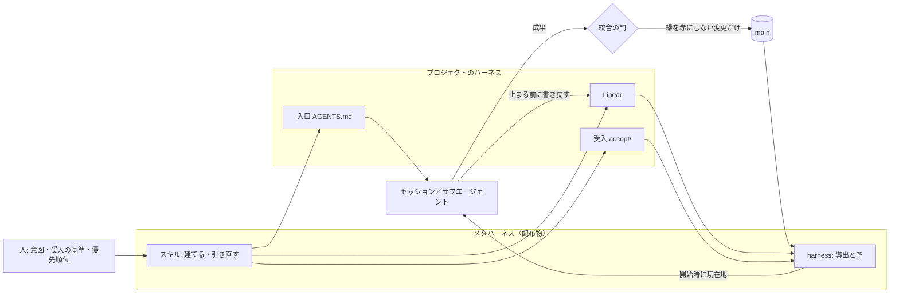

# 設計と、失敗の記録

スキル本文は読み込まない開発用の文書。要求の正本はユーザー原文（Codexのスレッド履歴にある）。ここはそこから導いた設計と、やってみて失敗したことの記録。進捗や現在地はここに書かない。Linear と `harness status` が持つ。

## 要求

出典は 2026-08-31 から 2026-09-23 のユーザー発言。日付とturn IDだけを示す。会話本文はここへ複製しない。

**目的**（`01a0582b`、`01a07b90`）。どの開発・サービス・リポジトリでも、PMコンテキストをLinearへ外部化して好循環を構造的に再現する。解きたい症状は、全体像を渡してもGitで追えない単位の決定が保存されず、確定仕様が壊され、永遠にデグレし、注意に振り回されて異常に細かい作業を繰り返し、進まないこと。

**理論**（`01a05823`、`01a05826`）。Y=F(X)。出力はモデルの性能と整備された入力に依存し、その出力が次のセッションの入力になる。過剰実装と報酬ハッキングを繰り返すので、Xをクリーンに保ち続ける必要がある。XにはCodexが起動されたリポジトリのコードベースも含まれる。実装計画の時点でE2Eを決め、テストコード自体も読み込まれる入力として別のエージェントに定性レビューさせる。入力装置はリポジトリごとに用意する。

**一番恐れていること**（`01a07b90`、`01a07bd6`）。古いコンテキストがリフレッシュされないこと。汚染されるとそれに気づくことすらできない。前の失敗で欠けていたのは、計画を実際の実行経路・外部状態と結び付け、誤りが判明したときに現在の文脈を更新する仕組み。各部品のテストと完了報告が揃っても、つないだ利用者の体験は成立しない。

**構造**（`01a07bbc`、`01a07bd6`）。Milestoneは疎結合なモジュール単位。リポジトリもコンテキストなので、ディレクトリは会社の部署のように分ける。複数にまたがるコンテキストの回収は構造的に苦手。テストの定義とGit運用（mainはE2Eまで通ったものだけ、ブランチの切り方、統合の基準）もスキルの職責。

**理想の使い方**（`01a061ea`）。「Linearに従ってサブエージェントを好きなだけ呼び出して完成させてください」と言えば進むこと。ユーザープロンプトに依存しすぎるなら意味がない。

**作り方への制約**（`01a057ff`、`01a061b5`、`01a061e0`、`01a07c2a`、`01a07dc7`）。最小のコード・最小のファイル・最小の依存・最小の工数。過剰実装にならないことが一番重要。2026-09-02 の時点で報酬ハッキングの警告が出ている（サブエージェントに監査させようとしたら、監査されること自体が報酬になって改善が止まった）。同日に「分割しすぎでは」「迎合しかしなくなってきた」。2026-09-08 に「簡単にできることを難しくやっていたり、手続きのための手続きが連鎖していないか」。優先順位は、第一に迅速な完成、第二に意図が正しく反映されること。

ユーザー自身が書いた監査プロンプトにも同じ基準が入っている。SKILL.mdが規則の投棄場所になっていないか。手続きのための手続きがコンテキストを汚していないか。規則の数を品質として扱わないこと。

**最初の構想は2系統だった**（2026-09-07 `01a07bd6`）。現実からLinearを起こして引き直すもの（refresh）と、作業の進行をHookと組み合わせて固定するもの（PM）。出発点は「確率的に出てくる出力を、収束させるための装置を意図的に作る」「ハーネスより一段上のシステム」（2026-08-31 `01a0572a`）。

## 根幹の問題

**ループを閉じる働きを、モデルが文章に従うことに頼っていた。** 固定する側は機構のはずだったのに、作られたものは2回とも、規律を文章で求めるものだった。

| | 引き直す側 | 固定する側 |
|---|---|---|
| 構想 | 現実からLinearを起こす | Hookと組み合わせて固定する |
| Codex版（2026-09-23 配布、2026-10-14 撤去） | 規則文（3スキルと182行の共通契約） | `linear` の語で発火し、規則文を差し込むHook |
| 文章1ファイル版（2026-11-06） | 規則文 | なし。Hookごと捨てた |

文章1ファイル版の試行が、そのまま証拠になった。

| 文章で求めたこと | 結果 |
|---|---|
| 決着済みIssueの本文を点検する（置き場所と言い方を変えて7通り） | 6通りが 0/3。1通りは本文が読み込まれず測れなかった |
| 完成時に `AGENTS.md` を書く（2通り） | 変化なし |
| 使えない機能があれば止まる | 実装がゼロになる回帰 |
| 文を足す | 2通りで、ほかの項目が落ちた |
| `続きやって` でスキルが選ばれる | 0/4。選ばれなければ本文は存在しないのと同じ |

| 構造に置いたこと | 結果 |
|---|---|
| 入口（`AGENTS.md`）に対象と「確認が要る操作」を書く | スキルが読み込まれなかったセッションも、この1行を根拠に時給の変更を拒否した |
| 完了条件に、実装より先に実数を書く | テストごと書き換えた改ざんを、冷たい2本が両方検出した |
| 成果の所在を commit で書く | 改名後に到達できたのは commit 8/8、パス 1/4 |

文章は、効いたとしても次のセッションでまた賭けになる。構造は、読まれなくても残る。

帰結は、完成を判定できなかったこと。正しさを「エージェントの振る舞い」の上に定義すると、振る舞いは分布なので、何本回しても「3本中3本」としか言えない。試行が70本を超え、PRが32本になっても終わらなかった。

## メタハーネス

**ハーネス**は、あるプロジェクトで、セッションに渡す入力を決め、出力を現実と突き合わせ、結果を次の入力へ書き戻す仕掛け。プロジェクトごとに違う。**メタハーネス**は、どのプロジェクトにもそのハーネスを建て、現実から引き直す仕組み。理想の指示にスキルの名前が出てこないのは、実行時に従う相手がスキルではなく、建てられたハーネスだから。

| 収束に要るもの | 担うもの |
|---|---|
| 目標状態 | 受入。実装より先に書く。main で緑になったものが確定仕様 |
| 計測 | 導出。main の受入結果とLinearから毎回計算する。記憶しない |
| 逆戻り止め | 門。緑だった受入を赤にする変更は入らない。Linearが現実とずれたままでは止まれない |
| 引き直し | セッション開始時に導出結果を渡す |

割り当ての原則は1つ。**判断が要ることはスキル、要らないことは機構。** 文章の規則は、測って差が出たものだけを入口に1行で残す。初期値は0行。

## 作ったもの

配布物は2ファイル。[skills/linear-workflow/SKILL.md](skills/linear-workflow/SKILL.md) と `skills/linear-workflow/harness`。**ファイルを増やす変更は、理由をここに書いてから行う。** 2つ目を足した理由は、上の「根幹の問題」。

| 層 | 中身 | 読まれる時 |
|---|---|---|
| スキル | 建てる・引き直すの手順と、ハーネスの型 | 建てる時と、食い違いを直す時だけ |
| `harness` | 導出と門。Python 3 の標準ライブラリだけ。モデルを呼ばず、Linearには書かない | フックとCIが毎回呼ぶ。モデルは中を読まない |
| 入口 | `AGENTS.md` の `## 進め方`。正本、Linearの叩き方、受入、モジュール、確認が要る操作 | 毎セッション |
| Linear | 完成条件、モジュール（Milestone）、開いている仕事、経緯 | 導出結果として毎セッション |

`harness` の呼び出し。

| 呼び出し | いつ | すること |
|---|---|---|
| `status` | セッション開始のフック | main の版を追跡ファイルだけの場所で走らせた受入結果と、LinearのIssueを突き合わせ、現在地（緑・赤・未実装、前線、待ち、食い違い）を十数行で出す。食い違いがあれば、直す手順の場所（`SKILL.md` の「引き直す」）も出す |
| `check` | 停止のフック | このセッションで新しく生じた食い違いが残っていれば止め、名指しする。同じ理由で止めるのは2回まで。3回目は通す（残った食い違いは次の `status` に出る） |
| `check --wellformed` | 建てるの終わり | 入口、受入、所在、フック、CIの門が揃っていて、食い違いが無いかを終了コードで返す |
| `gate` | CI | 基準の版で緑だった受入が、赤になるか消えるなら通さない |
| `accept` | 受入コマンド | `accept/<Issue ID>_…` を1本ずつ走らせ、`緑／赤 Issue ID 説明` を出す |
| `setup` | 建てる | フック（`.claude/settings.json`、`.codex/hooks.json`）とCIを登録する |

うまくいかない時は、止めない側に倒す。入口が無ければ何も出さない。Linearに届かなければ、その旨を1行出して通す。

名指しする食い違い。

- Done なのに受入が落ちている／main の受入に出てこない／証拠のリンクが無い
- 受入が、Issueに書いた版（`パス@commit`）から変わった・消えた。ブランチや作業ツリーが main の受入を変えている
- In Progress なのにブランチも commit も無い。commit があるのに Todo のまま
- 受入が main で緑なのに閉じていない。Todo なのに受入が無い
- Canceled なのに受入が残っている。受入の出力に、ProjectにIssueの無いIDがある
- 自動の受入を持つ、開いているIssueが、受入を見直すIssueを待っていない。待っているものが終わる前に着手している
- モジュール表と、ディレクトリ・Milestone が合わない。Projectの状態が実態と合わない
- commit されていない変更がある

LinearのGitHub連携は、Issue ID を名前に持つブランチのPRがマージされると、そのIssueを閉じる。受入だけを先に入れるPRでこれが起きると、受入が赤いまま Done になる。機構は「Done だが…」と名指しする。受入だけのブランチには Issue ID を付けない。

それぞれの行に、どう直すかを付けて出す。

前の版が撤去された原因（全体に効く、語で発火する、規則文を差し込む）は、3つとも持たない。フックはリポジトリ単位で、運ぶのは状態。

**実装して、提案から変えたこと。**

| 提案 | 実装 | 理由 |
|---|---|---|
| CIは、受入が赤なら入れない | 緑だった受入が赤になるなら入れない | 受入は実装より先に main に入る。Todo の受入は main で赤い |
| 最後に全部緑だった commit からの受入の差分を出す | Issueに書いた所在 `パス@commit` と main を比べる | 「最後の全緑」は記憶が要る。所在なら、Linearとgitだけから毎回導出できる。受入を変える側は、Issueの所在を書き直すという見える操作を要求される |
| フックの登録と受入の実行はスキルの手順 | `setup` と `accept` として機構に入れた | 判断が要らない |
| In Review の述語 | 外した | 着手中と区別する機構上の必要が無かった |
| 停止の門は、現実が動いたのにLinearが動いていなければ止める | 開始時に無かった食い違いだけで止める | 前からある食い違いで、関係のない質問のたびに止めないため |
| （無かった） | commit されていない変更も食い違いにする | 完成まで進める試行の1本目が、実装を commit せず、Linearも動かさずに止まり、門がそれを通した。次のセッションからは何も見えなかった |
| （無かった） | 食い違いがあるとき、現在地に手順の場所を出す | スキルが選ばれることに頼らないため。冷たい2本目は、この行から本文を読んで書き戻した |
| フックは標準入力を読む | フックは `--hook` を付けて呼ぶ。付いていなければ読まない | 標準入力が閉じないシェルから手で走らせると、止まった |
| 形（入口、Issueの受入、所在）はスキルに書く | `harness` が引数なしで自分の形を出す。スキルはそこを指す | 建てるセッションが、形を確かめるために `harness` の中身を400〜760行読んだ。「読む必要はない」と書いても読む |
| 建てるの手順で、受入を別の文脈に攻めさせる | 受入の見直しをIssue（受入の4つ目の型）にして、自動の受入を持つIssueを全部それに待たせる。待っていなければ名指しする | 文章の手順では、建てる試行3本のうち1本しか実行されなかった。省かれた回は、誤った期待値が実装の段階まで残った。Issueにすれば、次に入る冷たいセッションが実装より先にやる。建てるセッションにはまだフックが無いので、機構が見られるのは Linear の形だけ |

## 完成条件

合否は終了コードか文字列の一致で決まる。観測者が記録を読んで判断する項目は置かない。判定の結果は、それぞれのIssueの受入が持つ（ここには写さない）。

1. 機構のテスト。書き換えた受入、Done の赤、到達できない所在、状態の食い違いを仕込んだ固定データに対して `harness` が名指しする。門と遮断器も同じ
2. 空のリポジトリと1文の意図から建てた結果が `harness check --wellformed` を通る
3. そのリポジトリで「Linearに従ってサブエージェントを好きなだけ呼び出して完成させてください」と言うと、通しの受入が main で緑になり、停止の門を通って終わる
4. ハーネスの無いリポジトリでは、何も出さない
5. 最初の適用先は、このリポジトリ自身

## 前の2版から残すこと

**Codex版**は、3スキル＋182行の共通契約＋Hook＋installer＋16項目の採点表＋11 Milestone＋49 Issue。採点表・監査記録・受入レビューが成果物の中心になり、循環そのものは実装されなかった。2026-10-14 に、進行中の開発への干渉を理由にユーザーの指示で撤去された。コンテキストを汚さないための装置が、環境内で最大のコンテキスト汚染になっていた。Linear Project `052491f9-4937-4c82-8bb5-c7b0fb563ecd` は Completed のまま残っているが、実物は無い。

**文章1ファイル版**の本文と、試行の全記録（方法、結果の表、稼いだ変更、取り消した変更）は、commit `acfbbd9` の `DESIGN.md` と `SKILL.md` にある。持ち越した知見は次のとおり。

- 選択はファイルを読む前に起きる。プロンプトにLinearを指す語が無いと、スキルは選ばれない。だから日々の進行をスキルの選択に依存させない
- セッションはIssueの一覧（識別子・タイトル・状態）を取り、必要なものだけ本文を開く。決着済みIssueの本文は読まれない。直らないが、次のセッションにも伝播しない
- 読む時間は記録の量に比例する（Issue 12本で約3分、55本で約40分）。だから読む経路を、開いている仕事に限る
- 所在はパスではなく commit で書く
- テストごと書き換えた改ざんは、テストでは見つからない。先に書いた実数の完了条件との突き合わせで見つかる
- 文を足すと、ほかが落ちる

**自分の失敗。**

- **検証の捏造。** 起動した担当に「スキルに従え」と伝えて通し、全項目通過と記録した。答えの注入だった。取り消した
- **検証のための検証。** 検証用のProject、指紋ファイル、判定書、変異スクリプトを積んだ。全部消した
- **限界を記録して降りる。** 「検証できない」と書いた2件は、どちらも検証できた。限界は記録しない。検証に変えるか、止めている機構を名指しできるまで降りない
- **文字数の誤測。** `wc -m` はロケール未設定だとバイト数を数える。decode してから数える
- **試行の条件で試行を壊す。** 同じ依頼の試行を、同じワークスペースと隣のフォルダで同時に回した。2本目は既存のProjectと隣のリポジトリを見つけて、作らずに確認を求めた（正しい挙動）。測りたかったことは測れなかった。同じ依頼は同時に回さない

## 試行のやり方

**答え・正解・修正箇所・次の操作は渡さない。** スキルを使えという指示も出さない。実行者は別文脈の非対話セッション（`claude -p`）。対象は使い捨てで、終わったら消して照合する。使っていない間に、観測で代用する装置を作らない。

- `claude -p --restricted` は、ファイルツールを作業フォルダに閉じ込め、user・project・local の設定を無視する。導入先の `.claude/skills/` は見えないので、`--plugin-dir <リポジトリ>/.claude` で載せる。リポジトリのフックも走らないので、登録された形のまま `--settings` で渡す。登録そのものが効くかは、信頼済みのこのリポジトリで、ツールなしのセッションを起動して確かめた
- `Bash(*文字列*)` の deny は実行者自身のパスにも当たる。`*/priv*` は `/private/tmp/…` に当たって、Linearの入口ごと塞いだ。守りたいものは拒否され、使わせたいものは通ることを、canary で両方確かめてから回す
- `Read(/path/**)` の deny はファイルツールを縛らない。信頼済みでないワークスペースでは `.claude/settings.json` の `allow` が無視される
- Linearへの書き込みは、試行が作ったProjectの中だけに絞る入口を通す。**入口はLinearのエラー文を見せること。** 見せなかった回は、セッションが原因を探るために空のProjectを作った
- 入口と観測者のファイルは、実行者から見える場所を分ける。同じ場所に置いた回は、実行者が入口の中身と状態ファイルを読みに行った。隣の使い捨てリポジトリ（`../`）も見える
- 合否は、セッションの報告ではなく、終わったあとの状態で決める。観測者が `harness check --wellformed`、追跡ファイルだけの場所での受入、`harness status` を走らせる
- `git reset --hard` では reflog と前のブランチが残る。やり直すなら `.git` を作り直す
- このリポジトリのセッションから起動したサブエージェントには `AGENTS.md` が注入される。スキルの試行には使えない
- zshは引用符なしの変数を単語分割しない。フラグは配列で渡す

**Issue上限。** 無料プランは、アーカイブされていないIssueが250件まで（`USAGE_LIMIT_EXCEEDED`）。終了状態でも数に入る。開けるのはユーザーの明示の指示があったときだけ（2026-11-06「止めてる機構があるなら削除するか変更すりゃいいだろ」）。

1. ユーザー自身が `ARCHIVE-PM-*` / `CANCELED_DO_NOT_REFERENCE_*` と名付けたProjectの、終了状態のIssueだけを選ぶ（255件）。生きているIssueには触らない。課金もしない
2. IDの一覧を保存してから `issueArchive`
3. 終わったら `issueUnarchive` で全部戻し、件数・所属Project・状態・`updatedAt` を照合する

## 採らない案

- **1ファイルの文章のまま磨く。** 追記は7通り試して効かず、足すほどほかが落ちた
- **全体に効くフック、語で発火するフック。** 撤去の原因
- **検証用のProject、採点表、判定書。** 合否は状態で決まるので要らない
- **規則を足して直す。** 直すのは型か機構
- **機構がLinearに書く。** 状態を動かすのは人とエージェント。機構は、動かし忘れを名指しするだけにする
