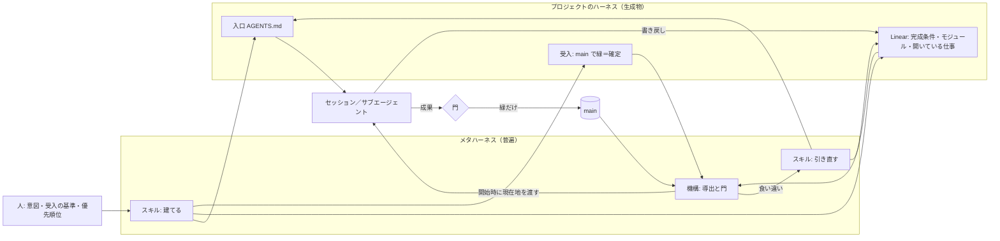

# 再設計: メタハーネス

状態: 提案（2026-11-10）。未実装。いまの配布物（[skills/linear-workflow/SKILL.md](skills/linear-workflow/SKILL.md)）は [DESIGN.md](DESIGN.md) の設計のまま動いている。実装したら、この文書が DESIGN.md を置き換える。

要求の出典はユーザー原文で、日付と turn ID だけを示す。

## 1. 根幹の問題

**ループを閉じる働きを、モデルが文章に従うことに頼っている。**

出発点は「確率的に出てくる出力を、収束させるための装置を意図的に作る」「ハーネスより一段上のシステム」だった（2026-08-31 `01a0572a`）。Y=F(X) の前提は、モデルの規律には期待できないということ。「開発過程のコンテキストに埋もれて、LinearやSSoTのメンテが省略される」という懸念も、最初から出ていた（2026-09-02 `01a061ea`）。

それなのに、作られたものは2回とも、規律を文章で求めるものだった。

| 最初の構想（2026-09-07 `01a07bd6`） | Codex版 | この版 |
|---|---|---|
| 現実からLinearを起こし、引き直す（refresh） | 規則文（3スキルと182行の共通契約） | 規則文（「計画をつくる・立て直す」「汚染に気づく」） |
| 作業の進行を、Hookと組み合わせて固定する（PM） | `linear` の語で発火し、規則文を差し込むHook | Hookを捨てた。固定する機構は無い |

構想は最初から2系統で、固定する側は機構だった。Codex版はHookを持っていたが、Hookが運んだのは状態ではなく規則文だった。この版は「最小のファイル」を「1ファイルの文章」と読み、機構ごと捨てた。いまの配布物は文章だけで、フックもスクリプトも0本。

この版の試行が、そのまま証拠になっている。

| 文章で求めたこと | 結果 |
|---|---|
| 決着済みIssueの本文を点検する（置き場所と言い方を変えて7通り） | 6通りが 0/3。1通りは本文が読み込まれず測れなかった |
| 完成時に `AGENTS.md` を書く（2通り） | 変化なし |
| 使えない機能があれば止まる | 実装がゼロになる回帰 |
| 文を足す | 2通りで、ほかの項目が落ちた |
| `続きやって` でスキルが選ばれる | 0/4。選ばれなければ本文は存在しないのと同じ |
| スキルの有無で判断が変わるか（直接聞いた6問） | 4問は差なし |

| 構造に置いたこと | 結果 |
|---|---|
| 入口（`AGENTS.md`）に対象と「確認が要る操作」を書く | スキルが読み込まれなかったセッションも、この1行を根拠に時給の変更を拒否した |
| 完了条件に、実装より先に実数を書く | テストごと書き換えた改ざんを、冷たい2本が両方検出した |
| 成果の所在を commit で書く | 改名後に到達できたのは commit 8/8、パス 1/4 |

文章は、効いたとしても次のセッションでまた賭けになる。構造は、読まれなくても残る。

**帰結は、完成を判定できないこと。** 正しさを「エージェントの振る舞い」の上に定義すると、振る舞いは分布なので、何本回しても「3本中3本」としか言えない。試行が70本を超え、PRが32本になり、完了条件を文で与えた停止フックが止まらなかったのは、この1つの原因から出ている。「このハーネス自体のE2Eテストはどう書くのか」（2026-09-20 `01a0bf0f`）に、いまの設計は答えられない。このプロジェクト自身も自分のハーネスを持っていない。状態は DESIGN.md に溜まり、完成条件は状態で書かれていない。

## 2. メタハーネスとは

**ハーネス**は、あるプロジェクトで、セッションに渡す入力を決め、出力を現実と突き合わせ、結果を次の入力へ書き戻す仕掛け。プロジェクトごとに違う（2026-08-31 `01a05826`、入力装置はリポジトリごと）。

**メタハーネス**は、どのプロジェクトに対してもそのハーネスを建て、現実から引き直す仕組み。成果物は仕事ではなく、仕事が収束する場。理想の指示「Linearに従ってサブエージェントを好きなだけ呼び出して完成させてください」にスキルの名前が出てこないのは、実行時に従う相手がスキルではなく、建てられたハーネスだから。

収束に要るものは4つで、どれも状態か機構で持つ。

| 要るもの | 役割 | 担うもの |
|---|---|---|
| 目標状態 | どこへ収束させるか | 受入。実装より先に書く。main で緑になったものが確定 |
| 計測 | いまどこにいるか | 導出。現実とLinearから毎回計算する。記憶しない |
| 逆戻り止め | 離れる方向を通さない | 門。統合は緑だけ。停止は書き戻してから |
| 引き直し | ずれを溜めない | セッション開始時に導出結果を渡す。閉じた経緯は読む経路から外す |

割り当ての原則は1つ。**判断が要ることはスキル（エージェントの手順）、要らないことは機構（コード）。** 文章の規則は、どちらにも落とせず、測って差が出たものだけを入口に1行で残す。初期値は0行。



## 3. アーキテクチャ

### 3.1 置き場所

| 層 | 中身 | 置き場所 | 読まれる時 |
|---|---|---|---|
| メタ | スキル。建てる・引き直すの手順と、ハーネスの型 | `skills/linear-workflow/SKILL.md` | 建てる時と、壊れた時だけ |
| メタ | 機構。導出と門の1本のスクリプト | `skills/linear-workflow/harness` | フックとCIが毎回呼ぶ。モデルは読まない |
| プロジェクト | 入口、フックの登録、受入、統合の門 | 各リポジトリ | 入口は毎セッション、必ず |
| プロジェクト | 完成条件、モジュール、開いている仕事、経緯 | Linear | 導出結果として毎セッション |

実行時にモデルが読むのは、入口の数行と導出結果の十数行だけ。普遍の規則文は読まない。スキルが選ばれるかどうかに、日々の進行は依存しない。

ほかの開発には干渉しない。フックはリポジトリ単位で、語では発火しない。入口が無いリポジトリでは、スクリプトは何も出さずに終わる。前の版が撤去された原因（全体に効く、語で発火する、規則文を差し込む）を、3つとも持たない。

### 3.2 入口

`AGENTS.md` の1ブロック。人とエージェントとスクリプトが同じ行を読む。設定ファイルを別に作らない。

```
## 進め方
- 正本: <Linear Project のURL>
- Linearの叩き方: <MCP、またはコマンド>
- 受入: <コマンド1つ>（出力は Issue ID ごとの緑・赤）
- モジュール: <ディレクトリ> = <Milestone>、…
- 確認が要る: <このプロジェクトで取り消しにくい操作>
```

### 3.3 状態の定義

Linearの状態を、現実から計算できる述語として定義する。述語と食い違う状態は、導出のたびに名指しで出る。

| 状態 | 成り立っていること | 遷移を起こすもの |
|---|---|---|
| Backlog | 受入がまだ書けない。粗いまま | — |
| Todo | 受入がある（赤）。Blocked by が無ければ前線 | 建てる・引き直す |
| In Progress | ブランチがある | 着手したセッション |
| In Review | PRがあり、ブランチで受入が緑 | PR（Linearの連携） |
| Done | 受入が main で緑。成果は commit | マージ（Linearの連携）。手では付けない |
| Canceled | 理由と、要求の移動先がある | 人の判断 |
| Project 完了 | 通しの受入が main で緑。開いているIssueが無い | 導出 |

受入は3つの型を持つ。**自動**（コマンドで再実行できる）、**証拠**（一度きりの観測。リンクと日付）、**人**（誰が確かめるか）。コード以外の仕事（調査、資料、設定、外部サービスの操作、人への連絡）は証拠か人になる。GitHubで追えない範囲の経緯は、Issueのコメントが持つ。

受入はIssueが所有し、名前にIssue IDを持つ。閉じたIssueの受入を変える変更は、そのIssueを開き直す変更として扱う。最後に全部緑だった commit からの受入の差分は、導出が毎回出す。

確定仕様とは、main で緑の受入のこと。受入に落ちていない仕様は、まだ確定していない。

### 3.4 機構

1本のスクリプト。標準ライブラリだけで書く。モデルを呼ばない。

| 呼び出し | いつ | すること | うまくいかない時 |
|---|---|---|---|
| `harness status` | セッション開始のフック | main の受入結果を取り、Linearの開いているIssueを引き、3.3の述語と突き合わせて、現在地を十数行で出す | 入口が無ければ何も出さない。Linearに届かなければ、その旨を1行出す |
| `harness check` | 停止のフック | このセッションで現実が動いたのにLinearが動いていなければ止めさせず、足りないものを名指しする | 同じ理由で2回止めたら、3回目は通して理由を残す |
| 受入コマンド | main への統合（CI） | 赤なら入れない | 入れない |

セッション開始と停止のフックは、Claude Code と Codex の両方にある（Codex 0.163.0 のバイナリで `SessionStart` と `Stop` を確認した）。Codexはリポジトリのフックを初回に人が信頼する必要がある。

`harness status` の出力は、たとえばこうなる。

```
現在地（導出 main@4ad8908）
受入  緑 12 ／ 赤 1 ／ 未実装 3
  赤  MAT-512 今日の予約4件が一覧に出る … Done なのに落ちている
前線  MAT-530、MAT-531
待ち  MAT-533（MAT-530 待ち）
食い違い
  受入が最後の全緑（3f2a1c）から変わった: accept/MAT-498_*.py
  MAT-520 In Progress だがブランチが無い
確認が要る  本番の設定変更、送信
```

「汚染に気づく」は、注意力ではなくこの出力になる。決着済みIssueの古い記述は、読む経路に無いので現在地を汚さない。確定の記憶は受入と commit が持つ。

停止の門は、この版で使われた停止フックと同じ発想で、条件の置き場所だけが違う。条件を「完成したか」という文に置くと、判定がモデルの読みになって終わらない。条件を状態の述語に置けば、数秒で決まる。同じ理由で止め続けない遮断器を持つ（2026-09-28 `01a0e7f1`）。

### 3.5 スキル

判断が要る2つの手順だけを書く。

**建てる。** 0からでも、すでにある実態からでもよい。人に聞くのは、意図、受入の基準、優先順位、取り消しにくい操作だけ。

1. 完成を観測できる結果で書く。Projectと、通しの受入（赤）ができる
2. 疎結合なモジュールに割る。Milestone とディレクトリが1対1になる
3. それだけで確かめられる単位に落とす。Issueと受入（赤）と Blocked by ができる。すぐやらないものは粗いまま Backlog
4. 受入を別の文脈に攻めさせる。「通るのに、利用者は使えない」状態を作れるなら、受入を直す
5. 入口、フックの登録、統合の門を生成する

終わりの条件は `harness check --wellformed` が通ること。開いている Todo に受入がある、受入コマンドが走る、入口のURLが引ける、モジュール表とディレクトリが一致する。

**引き直す。** `harness status` が出した食い違いを、現実を正として直す。Linearを現実に合わせる。古いコード、古い受入、古い記述を消す。意図が変わったなら、建てるの3から5を差分に対してやり直す。閉じた経緯はアーカイブする。終わりの条件は、食い違いが0件になること。

### 3.6 セッションが読む量

入口、導出結果、着手するIssue 1件、そのモジュールのディレクトリ。量は開いている仕事に比例し、履歴には比例しない。履歴を読む設計では、Issue 12本で約3分、55本で約40分かかり、決着済みの記述は直らなかった。

Linearに残すのは開いている仕事だけにする。閉じたIssueはアーカイブする。無料プランの上限は未アーカイブ250件で、いまのワークスペースは467件あり、新しいIssueを作れない。この設計では上限に当たらない。

### 3.7 並列

前線は、開いていて Blocked by が無いIssue。1つのIssueは1つのモジュールに収まり、1つのサブエージェントに渡せる。渡すのはIssueと入口だけ。モジュールをまたぐ仕事は「つなぎ」の Milestone のIssueにして、通しの受入を持たせる。受入を書く文脈と、実装する文脈は分ける。

## 4. いまの本文の行き先

| いまの節 | 行き先 |
|---|---|
| 三つの規則 | 状態の定義と門。文章としては消える |
| 最初に読む | 開始のフックが渡す |
| どこに何を置くか | スキルの「ハーネスの型」に縮む |
| 計画をつくる・立て直す | スキルの「建てる」「引き直す」 |
| 実行する（状態の表） | 状態の述語と、Linearの連携 |
| 詰まったとき | 門の遮断器。残りは消える |
| 汚染に気づく | `harness status` の食い違い |
| 完了にする | Done＝main で緑。停止の門 |
| 聞くこと、聞かないこと | 入口の「確認が要る」と、建てるの入力 |
| しないこと | 消える。構造が代わりをする |
| 接続 | 入口の「Linearの叩き方」 |

## 5. 完成条件

実装より先に決める。どれも終了コードか文字列の一致で決まる。観測者が記録を読んで判断する項目は置かない。

1. 機構のテスト。モデルを呼ばない。受入を書き換えた、Done の受入が赤、所在に到達しない、状態と述語が食い違う、を仕込んだ固定データに対して、`harness status` が名指しする。門と遮断器も同じ
2. 空のリポジトリと1文の意図から建てた結果が `harness check --wellformed` を通る
3. そのリポジトリで「Linearに従ってサブエージェントを好きなだけ呼び出して完成させてください」と言うと、通しの受入が main で緑になり、停止の門を通って終わる
4. ハーネスの無いリポジトリでは、フックもスキルも何も出さない
5. 最初の適用先を、このリポジトリ自身にする。この再設計の実装を、建てたハーネスの前線から進める

2と3はモデルを使うが、合否は状態で決まる。回数を重ねて分布を測る必要は無い。1は、いまの設計で5セッションかけて測った「改ざんに気づくか」を、数秒のテストに変える。

## 6. 実装の順番と前提

1. `harness` の status と check、そのテスト（完成条件1）
2. スキルを書き直す。実行時の規則は、建てるが生成する入口へ移す
3. このリポジトリに建てる（完成条件5）。以降は前線から進める
4. 完成条件2、3、4を通す

配布物は2ファイルになる（スキルとスクリプト）。CIの「1ファイル」の検査は、理由をこの文書に置いて「2ファイル」に変える。

前提が2つある。どちらもユーザーの判断。

- 閉じたIssueのアーカイブ。未アーカイブが上限を超えている間はIssueを作れず、3が始められない。Linearの自動アーカイブの設定か、完了・中止済みProjectのアーカイブで解ける
- スクリプトがLinearを読む手段。すでにある `linear-api` を使う想定

## 7. 採らない案

- **1ファイルの文章のまま磨く。** 追記は7通り試して効かず、足すほどほかが落ちた
- **全体に効くフック、語で発火するフック。** 撤去の原因。フックはリポジトリ単位で、運ぶのは状態
- **検証用のProject、採点表、判定書。** 合否が状態で決まるので要らない
- **規則を足して直す。** 直すのは型か機構
